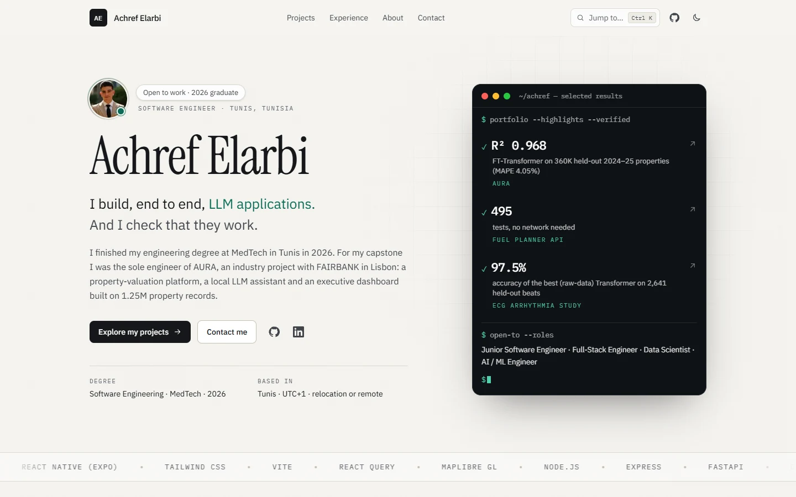
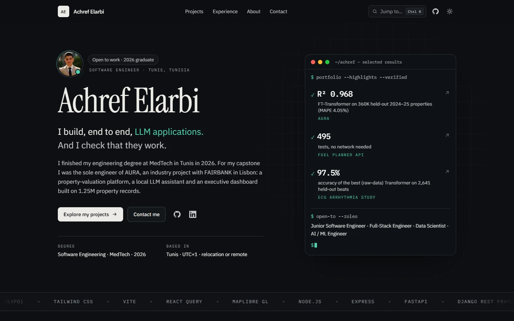
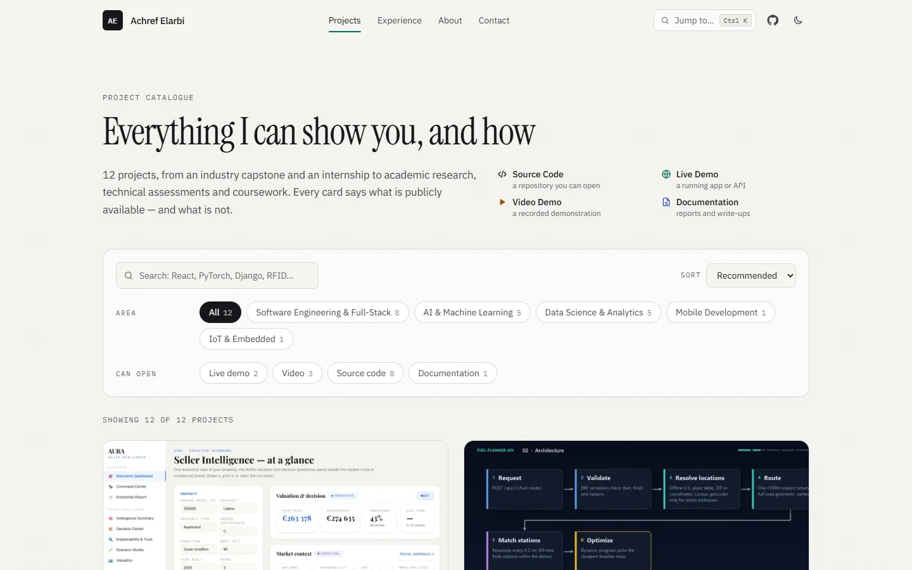
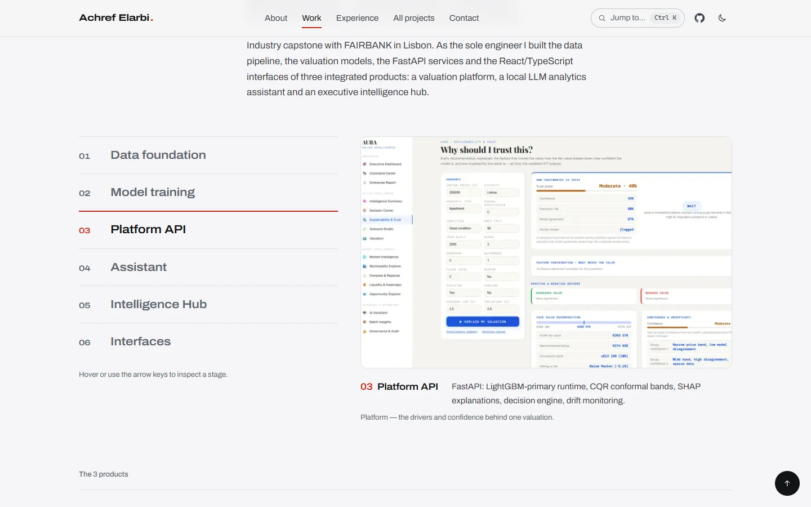
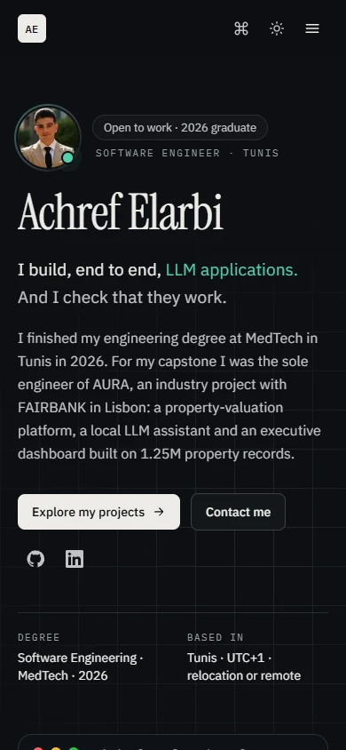

<div align="center">


# Achref Elarbi — Software Engineer Portfolio

### Machine Learning · LLM Applications · Data Science · Full-Stack

**I build machine-learning systems, LLM applications and data products — and the full-stack software around them.**<br />
This is my portfolio: a fast, accessible, content-driven catalogue of that work.<br />
Every page is generated from typed data files — add a project by editing one file.

<br />

[](https://nextjs.org)
[](https://react.dev)
[](https://www.typescriptlang.org)
[](https://tailwindcss.com)
[](https://vercel.com/new)

<sub>**AI / ML & data**</sub><br />


[](https://github.com/Achref47)
[](https://www.linkedin.com/in/achref-elarbi-9a44b9298/)


<br />



</div>

<br />

## 🧠 What this portfolio shows

| Area | Skills | Where to see it |
|---|---|---|
| **Machine learning** | Gradient boosting (LightGBM, CatBoost), PyTorch Transformers, scikit-learn, SHAP explainability, conformal prediction | AURA valuation models · ECG arrhythmia analysis |
| **LLM applications** | RAG, text-to-SQL, AI agents, local LLMs (Ollama), Gemini API, LangChain, ChromaDB, MCP | AURA AI assistant · IBM RAG & agentic-AI labs |
| **Data science** | pandas, Polars, NumPy/SciPy, SQL, DuckDB, data fusion and feature engineering, honest evaluation | AURA data foundation · microbiome study · NYC forecasting |
| **Full-stack** | React, TypeScript, Node/Express, FastAPI, Django REST, React Native, auth, CI | Fuel Planner API · TaskFlow AI · Privilege Travel Platform |

<br />

## ✨ Highlights

|   |   |
|---|---|
| 🎯 **Recruiter-first homepage** | A hero that answers *who, what, and proof* in seconds — a "terminal" of verified results that link to their case studies. |
| 📚 **Honest project catalogue** | 12 projects with search, area filters and "can open" filters (live demo · video · source · docs). Filters live in the URL, so every view is shareable. |
| 🧩 **Case studies, not just cards** | Problem → solution → architecture → decisions → results → limitations, with a sticky section nav and reading progress. |
| ⌨️ **Command palette** | <kbd>Ctrl</kbd>/<kbd>⌘</kbd> + <kbd>K</kbd> (or <kbd>/</kbd>) jumps to any project, section, profile or action. |
| 🎬 **Tasteful motion** | CSS-first: word-reveal headline, typed terminal, count-up metrics, cursor spotlight, 3D tilt, scroll reveals. Zero animation libraries; fully off under `prefers-reduced-motion`. |
| 🌗 **Light & dark** | Light by default for everyone; visitors can switch to dark with the header toggle (remembered, no flash on load). |
| 🔍 **SEO-ready** | Per-page metadata, Open Graph image, JSON-LD `Person`, sitemap and robots, canonical URLs. |
| 🛡️ **Can't ship a broken link** | A content validator runs before every build (and every Vercel deploy): slugs, links, images and their sizes, alt text, references. |

<br />

## 🖼️ Screenshots

<table>
  <tr>
    <td width="50%"><br /><sub><b>Dark mode</b> — optional, via the header toggle; the site opens in light mode.</sub></td>
    <td width="50%"><br /><sub><b>Catalogue</b> — search, area and evidence filters, sorting.</sub></td>
  </tr>
  <tr>
    <td width="50%"><br /><sub><b>Case study</b> — facts, evidence links, problem / built / outcome.</sub></td>
    <td width="50%" align="center"><br /><sub><b>Mobile</b> — no horizontal scroll on any page.</sub></td>
  </tr>
</table>

<br />

## 🧱 Tech stack

| Layer | Choice |
|---|---|
| **Framework** | Next.js 16 (App Router, Turbopack, static generation with `generateStaticParams`) |
| **UI** | React 19, Tailwind CSS 4 (design tokens via `@theme`), no component or animation library |
| **Language** | TypeScript, strict; typed content models |
| **Fonts** | Instrument Serif, IBM Plex Sans, IBM Plex Mono via `next/font` (self-hosted) |
| **Images** | `next/image` + WebP; `sharp`-based optimiser script |
| **Quality** | Content validator, Node test runner (9 tests), ESLint, `tsc` |
| **Hosting** | Vercel (static output — no server, database or secrets) |

<br />

## 🚀 Quick start

Requires **Node.js 24** (≥ 22.18 works locally).

```bash
git clone https://github.com/Achref47/Portfolio.git
cd Portfolio
npm install
npm run dev        # http://localhost:3000
```

| Command | What it does |
|---|---|
| `npm run dev` | Development server with hot reload |
| `npm run check` | validate → test → lint → typecheck → build. **Run before pushing.** |
| `npm run validate` | Checks all content: links, slugs, images and sizes, alt text, references |
| `npm test` | Tests for the content rules |
| `npm run build` / `npm start` | Production build / serve it locally |
| `npm run image -- <file> <slug> [name]` | Optimise a screenshot to WebP and print the snippet to paste |
| `npm run og` | Regenerate the link-preview image (`public/og.png`) |

<br />

## 🗂️ Project structure

```
.
├── src/
│   ├── content/            ← edit these to change what the site says
│   │   ├── profile.ts        name, headline, intro, about, links, photo, résumé switch
│   │   ├── projects.ts       every project (order = "Recommended" order)
│   │   ├── site.ts           title, navigation, featured projects, hero results
│   │   ├── experience.ts     jobs, education, certifications, awards
│   │   ├── skills.ts         skill groups and the full-stack map
│   │   ├── categories.ts     filter areas and project-type labels
│   │   └── types.ts          the shape of all content, documented field by field
│   ├── app/                pages, layout, sitemap, robots, favicon
│   ├── components/         cards, catalogue, palette, gallery, players, header…
│   └── lib/                helpers that read the content
├── public/                 images, per-project screenshots, OG image
├── scripts/                content validator + tests, image optimiser, OG generator
└── docs/                   content guide and README screenshots
```

> **Rule of thumb:** to change *what* the site says, edit `src/content/`. To change *how* it
> looks, edit `src/components/` or `src/app/`. No project data is hard-coded in components.

<br />

## ➕ Adding a project

1. Optimise a screenshot: `npm run image -- "path/to/shot.png" my-project dashboard`
2. Add one entry to the `projects` array in `src/content/projects.ts`:

   ```ts
   {
     slug: "my-project",
     title: "My Project",
     tagline: "One sentence that says what it does.",
     summary: "Two or three sentences for cards and search.",
     year: "2026",
     type: "independent",
     context: "Personal project",
     role: "Sole developer",
     categories: ["software"],
     tech: ["React", "FastAPI"],
     resources: [{ kind: "source", label: "Source code", href: "https://github.com/Achref47/my-project" }],
   },
   ```

3. `npm run check`, commit, push. It appears in the catalogue, filters, search, sitemap,
   command palette and related-project suggestions automatically.

Resource kinds are strict so the site never overclaims: `source`, `live` (never a video), `video`
and `docs`. A project with nothing public gets an `availabilityNote` instead.

📖 **Full guide** — editing, removing, reordering, featuring, metrics, media, profile and résumé:
[`docs/CONTENT_GUIDE.md`](docs/CONTENT_GUIDE.md)

<br />

## ☁️ Deploying to Vercel

No environment variables or secrets are required.

1. Push this repository to GitHub.
2. On [vercel.com/new](https://vercel.com/new), import it. Keep the defaults (framework
   **Next.js**, build `npm run build`, Root Directory `./`) and deploy.
3. Every push to `main` deploys to production; other branches get preview URLs.
4. *(Optional)* Add a custom domain and set `NEXT_PUBLIC_SITE_URL=https://your-domain.com` so
   canonical links, the sitemap and `robots.txt` use it.

The content validator runs inside the Vercel build, so a broken image path or link fails the
deployment instead of going live.

<br />

## 🎨 Design & engineering notes

- **Identity:** an "engineer's notebook" — warm paper background with faint grain, ink text, one
  green accent. Serif for names and titles, sans for text, mono for metadata and numbers.
- **Progressive enhancement:** content is in the HTML and readable without JavaScript;
  `prefers-reduced-motion` turns motion off.
- **Accessibility:** landmarks, skip link, one `<h1>` per page, labelled controls, visible focus
  rings, keyboard-operable menu, filters, palette and image viewer, alt text enforced by the
  validator.
- **Performance:** static HTML, WebP via `next/image`, YouTube embeds load only on click.
- **Honesty by design:** each project states what is publicly available and what is not; metrics
  must carry the context in which they were measured. See
  [`PORTFOLIO_AUDIT.md`](PORTFOLIO_AUDIT.md) for the review behind the current version.

<br />

## 🔒 Privacy

The portfolio repository contains only the website. The AURA product repositories are private
and are intentionally **not** linked or published here; their case study describes them without
exposing source code. Résumé download is off by default because the current CV contains a phone
number.

<br />

<div align="center">

**Achref Elarbi** · Software Engineer · Tunis, Tunisia<br />
[GitHub](https://github.com/Achref47) · [LinkedIn](https://www.linkedin.com/in/achref-elarbi-9a44b9298/)

<sub>Open to junior software engineering, full-stack, data science and AI/ML roles.</sub>

</div>
